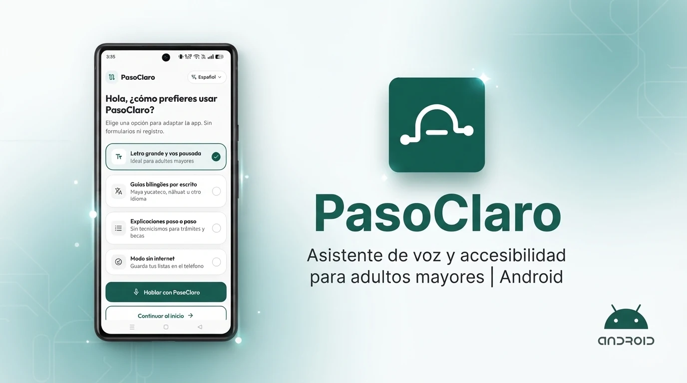
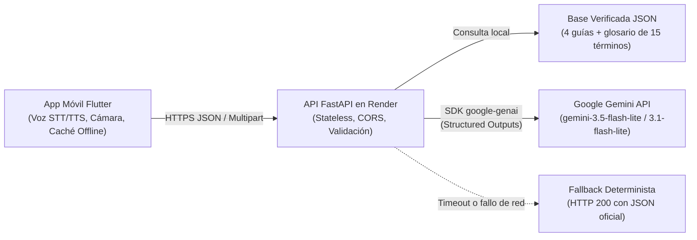

# PasoClaro — Documentación Básica (Hackatón UVM Ingenio Incluyente)

**Reto:** Reto 1 · Puentes de oportunidad (Reducción de la brecha de acceso — ODS 10)  
**Equipo:** Carlos Ysidro Junco Vázquez, José Ángel León Cortés y Fidel Ernesto Jacinto Pérez  
**Repositorio:** https://github.com/Chousim/PASOCLARO.git  
**Bocetos y Wireframes (Stitch):** https://stitch.google.com/projects/7125630527258665541  
**Backend en vivo (Render):** https://pasoclaro.onrender.com ([Estado `/health`](https://pasoclaro.onrender.com/health) · [Swagger `/docs`](https://pasoclaro.onrender.com/docs))

**Link de Descarga:** [PASOCLARO APK](https://github.com/Chousim/PASOCLARO/releases/download/v1.0.1/app-release.apk)  
**Link de video del programa:** https://drive.google.com/file/d/16YciQIGJbIGRJiGM8nUUyzWF6UUdAAO0/view?usp=sharing

---

## 1. Resumen ejecutivo

**PasoClaro** es una aplicación móvil accesible que actúa como acompañante inteligente por voz, texto y cámara para traducir trámites públicos en México (salud, apoyos sociales, becas y empleo) en guías y checklists paso a paso disponibles sin internet. Ayuda a adultos mayores, comunidades indígenas, migrantes, estudiantes de primera generación y personas con baja conectividad. Su innovación combina lectura multimodal de documentos con Google Gemini, detección previa de requisitos faltantes, respaldo determinista ante fallos de red y tarjetas bilingües escritas en maya yucateco y náhuatl con español sencillo e íconos visuales.

---

## 2. Boceto y concepto

### El problema
La información oficial sobre trámites, servicios de salud, becas y apoyos sociales suele estar dispersa, redactada con jerga legal o médica y diseñada para personas con alta alfabetización digital. Esta barrera deja fuera de derechos y oportunidades básicas a adultos mayores, hablantes de lenguas indígenas, población migrante, estudiantes de primera generación y habitantes de comunidades con conectividad intermitente, quienes abandonan procesos, dan vueltas innecesarias en ventanilla o pierden apoyos por no comprender los requisitos.

### Propuesta de solución
**PasoClaro** actúa como un traductor y guía personal entre la ciudadanía y las instituciones públicas. Con una configuración inicial de dos toques o por voz —sin registro ni contraseñas—, la aplicación adapta su interfaz al perfil de la persona, responde sus dudas, lee fotografías de documentos oficiales, identifica qué papeles faltan antes de acudir a una ventanilla y guarda un checklist paso a paso en el teléfono para consultarlo sin conexión a internet.

### Boceto de experiencia y flujo principal
- **Prototipo visual (Wireframes):** https://stitch.google.com/projects/7125630527258665541
- **Pantalla 1 — Selección rápida de perfil e idioma:** Botones grandes de alto contraste o activación por micrófono para elegir perfil (`senior`, `bilingual`, `student` u `offline`) e idioma (`es`, `yua` o `nah`). *(La atención a población migrante se contempla mediante lenguaje claro y perfil bilingüe).*
- **Pantalla 2 — Cuatro caminos claros:** Acceso visual mediante íconos grandes a **Salud**, **Trámites y Apoyos**, **Educación y Becas** y **Empleo** (con enfoque prioritario del MVP en **Salud** y **Trámites**).
- **Pantalla 3 — Asistente y escáner:** Espacio para preguntar hablando o escribiendo, o tomar foto a una receta, hoja de referencia, volante o convocatoria.
- **Pantalla 4 — Guía paso a paso y checklist offline:** Lista verificable de requisitos con íconos, tarjetas bilingües (cuando aplica) y datos oficiales de contacto.

### Alineación con los ODS 10 y 11
- **ODS 10 (Reducción de las desigualdades):** Elimina barreras lingüísticas, digitales y burocráticas para que poblaciones históricamente desatendidas comprendan y ejerzan sus derechos en igualdad de condiciones, promoviendo la inclusión social y el acceso equitativo a servicios públicos.
- **ODS 11 (Ciudades y comunidades sostenibles):** Facilita que personas vulnerables y habitantes de zonas periféricas o rurales accedan de forma efectiva a los servicios básicos de su entorno (clínicas públicas, oficinas de atención y programas sociales), evitando traslados innecesarios y fortaleciendo la resiliencia comunitaria.
  - **Meta 11.1:** Asegurar el acceso universal de todas las personas a servicios básicos adecuados y asequibles.
  - **Meta 11.a:** Apoyar los vínculos económicos, sociales y ambientales positivos entre las zonas urbanas, periurbanas y rurales mediante una mejor conexión de la población con los servicios institucionales.

---

## 3. Documentación funcional

1. **Onboarding adaptativo sin registro:** Permite configurar el perfil de uso (adulto mayor, bilingüe, estudiante o ahorro de datos/offline) y el idioma en dos toques o por voz, sin crear cuentas ni recordar contraseñas.
2. **Navegación por 4 caminos claros:** Organiza la orientación en **Salud**, **Trámites y Apoyos**, **Educación y Becas** y **Empleo**, respaldados por guías oficiales verificadas.
3. **Asistente conversacional guiado (voz y texto):** Permite preguntar hablando o escribiendo y responde en texto limpio (sin Markdown ni emojis) optimizado para lectura en voz alta pausada en español, proponiendo siempre una pregunta siguiente y botones de respuesta rápida para abrir la lista paso a paso o el escáner.
4. **Escáner multimodal de documentos oficiales:** Analiza fotografías (JPG, PNG o WebP) de recetas médicas, hojas de referencia, volantes o convocatorias para identificar el tipo de documento, explicar su contenido en lenguaje cotidiano, extraer fechas límite y folios (o marcar `[por verificar]` / `[sin folio]` si no son visibles), alertar sobre posibles faltantes y enlazar con la guía oficial correspondiente.
5. **Tarjetas bilingües en lenguas originarias (solo texto):** Genera explicaciones escritas en formato bilingüe (**maya yucateco** o **náhuatl** en la parte superior y **español sencillo** debajo) apoyadas en un glosario validado de 15 términos institucionales e íconos visuales, evitando distorsiones fonéticas de los lectores de voz convencionales.
6. **Detector de huecos y checklist interactivo offline:** Compara los documentos que el usuario ya marcó como listos contra los requisitos oficiales, avisa cuáles faltan y cómo obtenerlos gratuitamente, y guarda la lista en el dispositivo para consultarla sin señal.
7. **Canalización oficial verificable:** Muestra únicamente canales institucionales reales (teléfonos, horarios y portales `.gob.mx`) para prevenir fraudes o intermediarios.

---

## 4. Documentación técnica

### Arquitectura general
La solución sigue una arquitectura cliente-servidor ligera y sin estado (*stateless*), diseñada para baja conectividad y alta disponibilidad:

- **Cliente móvil (Flutter):** Gestiona la accesibilidad visual, la captura de voz (STT) y lectura en voz alta (TTS en español) en el dispositivo, la captura/compresión de fotografías y la persistencia local de guías y checklists para operar sin internet.
- **Backend orquestador (FastAPI):** No usa base de datos externa ni almacena fotos o datos personales; recibe cada consulta con su contexto ligero, carga requisitos verificados y el glosario desde archivos JSON estáticos y ejecuta una llamada estructurada hacia Google Gemini.
- **Estrategia lingüística en una sola llamada:** Para maya yucateco (`yua`) y náhuatl (`nah`), Gemini realiza la simplificación y redacción bilingüe apoyado en `glossary.json` (15 términos institucionales validados), reduciendo latencia y evitando dependencias de traductores externos.
- **Resiliencia con fallback determinista:** Si Gemini excede el límite interno (`9 s` en chat o `16 s` en escáner) o ocurre un fallo de servicio, el servidor responde igualmente con `HTTP 200` usando una respuesta segura generada desde `knowledge_base.json` y `glossary.json`.

### Stack tecnológico
- **Frontend móvil:** Flutter (Android, alto contraste, tipografía escalable, reconocimiento y síntesis de voz en español, cámara y almacenamiento local con SQLite / Hive).
- **Backend / API:** Python 3.11+ con **FastAPI**, **Uvicorn** y **Pydantic v2**, desplegado en **Render** (`BackEnd/Procfile`).
- **Motor de Inteligencia Artificial:** **Google Gemini API** mediante el SDK oficial `google-genai`, usando **`gemini-3.5-flash-lite`** como modelo principal y **`gemini-3.1-flash-lite`** como respaldo automático, con *Structured Outputs* en JSON y análisis multimodal de imágenes.
- **Gestión de datos (*Stateless*):** Archivos JSON locales verificados en el servidor (`BackEnd/app/data/knowledge_base.json` y `BackEnd/app/data/glossary.json`) y persistencia local offline en el teléfono.

### Integración de Gemini en el flujo de la aplicación
1. **Asistente conversacional (`POST /api/assistant/chat`):**
   - Flutter envía un JSON ligero con `{perfil, idioma, tramite, docs_completados, mensaje}` (el audio captado por micrófono se transcribe previamente a texto en el dispositivo).
   - FastAPI inyecta la guía verificada del trámite (`salud`, `tramites`, `educacion` o `empleo`) y el glosario correspondiente en el *system prompt*, aplicando reglas por perfil (`senior`, `bilingual`, `student`, `offline`) e idioma (`es`, `yua`, `nah`).
   - Gemini devuelve una salida estricta en JSON (`ChatResponse`: `respuesta`, `etiqueta_oficial`, `pregunta_siguiente`, `respuestas_rapidas`), que el backend sanitiza para asegurar texto limpio compatible con TTS.
2. **Escáner multimodal (`POST /api/scanner/analyze`):**
   - Flutter envía `multipart/form-data` con `perfil`, `idioma` y `file` (imagen JPG, PNG o WebP de hasta 10 MB).
   - Gemini analiza la imagen junto con las guías oficiales de referencia y devuelve una salida estructurada (`ScannerResponse`: `tipo_documento`, `titulo_corto`, `explicacion`, `fecha_limite`, `folio`, `alerta_faltante`, `guia_id`).
3. **Catálogo oficial para caché offline (`GET /api/guides` y `GET /api/guides/{guide_id}`):**
   - Expone las 4 guías oficiales verificadas (`salud_cita_clinica`, `beca_apoyo_social`, `educacion_beca_escolar`, `empleo_servicio_nacional`) y los 15 términos del glosario para consulta y respaldo sin conexión.

### Endpoints disponibles en producción (`https://pasoclaro.onrender.com`)
| Método | Ruta | Descripción |
| :--- | :--- | :--- |
| `GET` | `/` | Información general del servicio y enlaces rápidos |
| `GET` | `/health` | Verificación de estado (`{"status": "ok", "service": "pasoclaro-backend"}`) |
| `POST` | `/api/assistant/chat` | Asistente conversacional guiado con adaptación por perfil e idioma |
| `POST` | `/api/scanner/analyze` | Escáner multimodal de documentos oficiales (`multipart/form-data`) |
| `GET` | `/api/guides` | Listado completo de guías oficiales y glosario intercultural |
| `GET` | `/api/guides/{guide_id}` | Detalle de una guía específica por identificador |

> **Nota sobre Render (plan gratuito):** Si el servidor permanece inactivo unos minutos, la primera petición puede tardar entre 30 y 50 segundos en activarlo. Se recomienda abrir `/health` antes de una demostración.

### Calidad, pruebas y documentación técnica adicional
- **Pruebas automatizadas:** El backend incluye **72 pruebas con `pytest`** (`BackEnd/tests/`) que validan los contratos JSON de todos los endpoints, las combinaciones de perfiles e idiomas, la limpieza de texto para TTS, validaciones de archivos, el fallback determinista y pruebas opcionales en vivo contra Gemini.
- **Guías técnicas dentro del repositorio:**
  - Instalación local y despliegue del backend: `BackEnd/README.md`
  - Guía de integración para Flutter: `BackEnd/FRONTEND_INTEGRATION.md`

---

## 5. Manual de usuario

### Paso 1: Instalar y abrir la aplicación
1. Descarga el archivo instalador (**APK**) de **PasoClaro** en tu teléfono Android desde [PASOCLARO APK](https://github.com/Chousim/PASOCLARO/releases/download/v1.0.1/app-release.apk) y ábrelo para instalarla (si tu teléfono pide permiso para instalar aplicaciones externas, acéptalo).
2. Toca el ícono de **PasoClaro** en tu pantalla para abrirla. No necesitas crear una cuenta, escribir correo ni recordar contraseñas.

### Paso 2: Elegir cómo quieres que te ayude
1. En la primera pantalla verás botones grandes y claros. Toca la opción que mejor se adapte a ti (por ejemplo: adulto mayor con letra grande y voz, lengua indígena / bilingüe, estudiante o ahorro de datos).
2. Elige tu idioma: **Español**, **Maya yucateco** o **Náhuatl**.
3. Si lo prefieres, toca el botón grande del **micrófono** y di con tus propias palabras qué necesitas.

### Paso 3: Elegir el tema de tu consulta
Toca uno de los **4 botones principales** en la pantalla de inicio:
- **Salud:** Para saber cómo sacar una cita médica, dónde atenderte o entender una receta.
- **Trámites y Apoyos:** Para conocer requisitos de documentos oficiales o programas sociales.
- **Educación y Becas:** Para entender cómo inscribirte o solicitar una beca paso a paso.
- **Empleo:** Para recibir orientación básica y gratuita sobre búsqueda de trabajo.

### Paso 4: Preguntar o tomar foto a un documento
Dentro del tema elegido tienes tres formas de pedir ayuda:
- **Hablando:** Mantén presionado el botón del micrófono, haz tu pregunta en voz alta y suéltalo para escuchar y leer la respuesta.
- **Escribiendo:** Escribe tu duda en el cuadro de texto y toca **Enviar**.
- **Con la cámara:** Toca el botón de **Tomar foto** (o **Escanear un documento**), apunta hacia tu receta médica, hoja de cita, referencia o folleto y toma la fotografía. La app te explicará en palabras sencillas qué dice el papel, qué fecha límite o folio tiene y si te falta algún sello o requisito.

### Paso 5: Revisar qué te falta y guardar tu lista sin internet
1. La aplicación te hará preguntas cortas para revisar qué papeles ya tienes en casa y te avisará si te falta alguno y dónde tramitarlo gratis.
2. Verás una **lista de pasos con dibujos** (como tu identificación, CURP o comprobante de domicilio). Si elegiste maya yucateco o náhuatl, verás la explicación escrita en tu lengua arriba y en español sencillo abajo.
3. Toca cada cuadro para marcar los documentos que ya juntaste. Esta lista se guarda en tu teléfono para que **puedas volver a verla aunque no tengas señal ni saldo de internet** mientras vas camino a tu cita o estás en la fila.
4. Al final de la lista encontrarás los teléfonos, horarios y páginas oficiales reales a donde debes acudir sin intermediarios.

---

## 6. Accesibilidad e impacto

### Características de accesibilidad
- **Diseño sin fricción:** Inicio en dos toques o por voz, sin registros, contraseñas ni formularios largos.
- **Adaptación visual y auditiva:** Tipografía escalable, interfaz de alto contraste y respuestas en texto limpio diseñadas para lectura en voz alta pausada en español.
- **Lenguaje claro:** Traducción de jerga médica, legal y administrativa a frases cortas y cotidianas adaptadas a cada perfil.
- **Pertinencia cultural y lingüística:** Tarjetas escritas bilingües (maya yucateco o náhuatl + español sencillo) respaldadas por un glosario validado e íconos visuales, permitiendo la lectura directa o el acompañamiento familiar/comunitario sin errores de pronunciación sintética.
- **Disponibilidad con baja conectividad:** Persistencia local offline de guías y checklists, más respaldo determinista en el servidor para que la orientación siga disponible incluso ante fallos temporales de conectividad con la IA.

### Privacidad y alcance informativo
- **Cero almacenamiento de datos personales:** El backend procesa consultas e imágenes únicamente en memoria y no guarda fotografías, historial ni información personal en servidores externos.
- **Orientación ciudadana responsable:** PasoClaro es una herramienta informativa de acompañamiento que canaliza exclusivamente a canales gubernamentales oficiales (`.gob.mx`); no sustituye la atención médica ni las resoluciones de las instituciones públicas.

### Impacto esperado
- **Mayor comprensión:** Incrementar el porcentaje de personas que identifican correctamente todos sus requisitos antes de acudir a una clínica o ventanilla.
- **Ahorro de tiempo y recursos:** Reducir el tiempo necesario para interpretar una receta, hoja de referencia o convocatoria (análisis de documentos en pocos segundos) y evitar traslados innecesarios o cobros de gestores.
- **Inclusión efectiva:** Facilitar que personas con poca experiencia digital, adultos mayores o hablantes de lenguas originarias ejerzan sus derechos en salud, educación, empleo y apoyos sociales de manera autónoma y segura.
